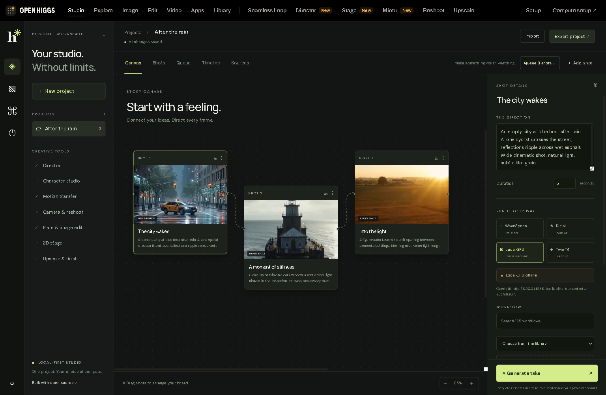

# Open Higgs

[](https://github.com/tosind/open-higgs/actions/workflows/ci.yml)
[](LICENSE)
[](https://github.com/tosind/open-higgs/releases)

A creative studio for planning shots, generating takes and cutting a film, with your choice of compute.



**One project, three ways to run inference:** paid APIs through WaveSpeed or Kie Market, your local ComfyUI GPU, or independent Kaggle twin T4 workers. No Higgsfield account is required. Open Higgs is an independent project built on [Openfield](https://github.com/wexloops/openfield).

## What works today

- A draggable story canvas, shot prompts, selected takes and a cut timeline.
- A searchable library of 125 ComfyUI API workflow recipes.
- Editable workflow settings, local node/model checks and media uploads.
- Persistent jobs and batch queues, with cancellation before a take starts.
- Idempotent requests and recovery of an existing provider task after a lost response.
- Local media saving, a soundtrack track and H.264/AAC film export.
- Versioned source snapshots, license notices and reproducible CPU-only protocol tests.

This is **v0.4.0-alpha.1**. Builds, protocol tests and a tiny video/audio export are verified. Real paid generation and GPU inference still need validation on actual provider accounts and hardware. Imported recipes require their own models and custom nodes; they are not a certified hardware catalog.

## Quick start

Install Node.js 22 or newer, then:

```powershell
git clone https://github.com/tosind/open-higgs.git
cd open-higgs
npm ci
npm run build
npm start
```

Open **http://127.0.0.1:3161**. The canvas, project editor and timeline work without a GPU. Choose an execution mode when you are ready to generate.

| Mode | Setup | Important limit |
| --- | --- | --- |
| WaveSpeed / Kie Market | Add your provider key to `.env` and select a model ID | Uses your provider balance; model inputs are explicit |
| Local GPU | Run ComfyUI, install the selected graph's nodes and weights | The new studio uses ComfyUI's native API; inherited tool pages also need `comfy-api-proxy` |
| Kaggle twin T4 | Upload the included notebook, choose T4 x2, configure a matching worker token and HTTPS worker endpoint | Two separate GPU workers, not a pooled 32 GB device |

See the [setup guide](docs/OPEN_HIGGS.md) for configuration, proxy setup and the [Kaggle notebook](notebooks/Open_Higgs_Twin_T4.ipynb).

## From shots to a film

Write prompts, choose a workflow and its backend, then generate individual takes or queue the project's shots. The Queue tab shows waiting, running and completed work. The scheduler starts one local render or two submissions per paid provider at a time; notebook workers claim Kaggle jobs independently. Waiting takes can be canceled without contacting a provider.

Select your best takes, reorder clips in Timeline, and optionally upload a WAV, MP3 or FLAC soundtrack. Export the timeline JSON. With Python 3.11 or newer and FFmpeg installed:

```powershell
python scripts/render_timeline.py timeline.json --output film.mp4
```

The renderer normalizes picture dimensions and frame rate, holds short clips, loops stills, and fits the soundtrack with an end fade. It does not preserve source-clip audio or provide multitrack editing. Save completed provider media locally before its URLs expire.

## Open source foundation

The application base is Openfield. The integration library includes recipes or reference material from Openjutsu, Genjustsu Open Source Workflow, Freefield, Open Source Canvas, Cinetic, OpenKatana, Backlot, ReAngle and Paint a Plate.

These have different integration depths. Some are runnable graph recipes when their dependencies are installed; others remain companion sources or creative references. Ten independent applications have not been fully ported into one runtime. The [contribution map](docs/RESEARCH.md) states what is actually included and lists additional candidate projects.

The application and new Open Higgs code use MIT. Copied Apache-2.0 components retain that license. All original licenses and required notices remain in [OPEN_HIGGS_NOTICES.md](OPEN_HIGGS_NOTICES.md) and `integrations/sources`. The manifest records immutable source trees and file hashes. Model weights, media and music have separate terms and are not granted a new license by this repository.

Original application documentation is preserved in [README.upstream.md](README.upstream.md).

## Contribute

Start with [CONTRIBUTING.md](CONTRIBUTING.md), [verification status](docs/VALIDATION.md) and [security guidance](SECURITY.md). Good first contributions are tested GPU profiles, clearer model setup, bug fixes and accessible editing controls.

```powershell
npm run build
npm test
npm run format:check
python scripts/verify_integrations.py
python scripts/check_publication.py
```

The CI matrix checks Linux with Node 22 and 24, and Windows with Node 24. No paid API or GPU is needed for the automated protocol tests.
